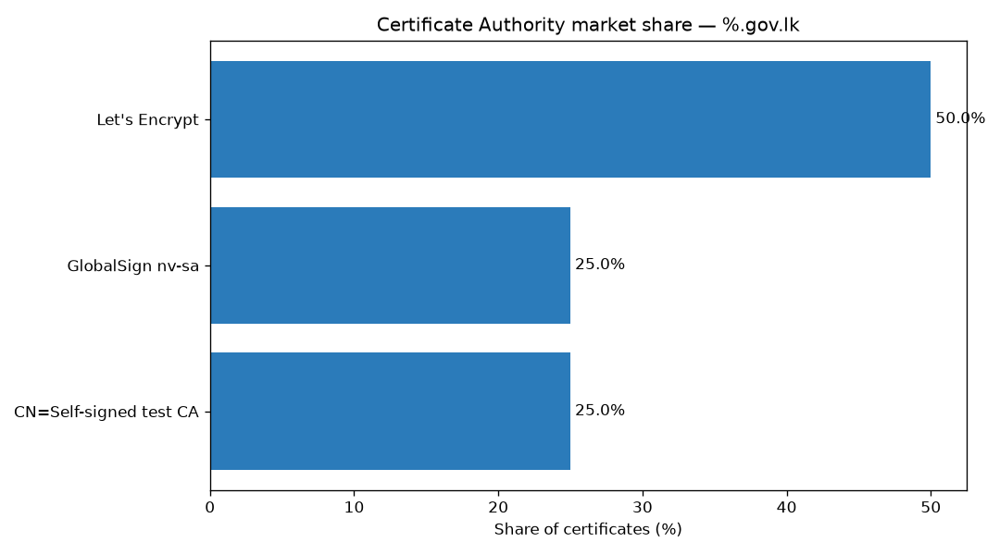

# ct-lens

[](https://github.com/your-org/ct-lens/actions/workflows/ci.yml)
[](LICENSE)
[](https://www.python.org/)

> An open-source tool that analyses **Certificate Transparency (CT)** logs to map the HTTPS
> certificate landscape of a whole top-level domain — starting with `.lk` (Sri Lanka) — using
> only public data, **without ever connecting to a target server**.

Every valid HTTPS certificate is recorded in public, append-only Certificate Transparency logs.
ct-lens reads that record (via [crt.sh](https://crt.sh)) and answers questions about a country's
— or any TLD's — certificate ecosystem: who issues its certificates, how certificate hygiene is
trending, and where public logs leak lookalike domains or internal hostnames. It is **defensive /
threat-intelligence tooling**: the same technique security teams use to watch their own brands.

It ships as a **command-line tool** and a **web dashboard**, both built on one shared engine.

---

## Why it's safe (and original)

- **Zero target contact.** ct-lens only reads CT logs. No live TLS handshakes, no scanning, no probing.
- **100% public data.** Everything comes from crt.sh. Nothing private is accessed.
- **Aggregate / anonymised by default.** Published output never names an organisation; findings are
  anonymised unless you explicitly opt out for private disclosure.
- **Reusable.** Default target is `.lk`, but any TLD, domain, or crt.sh pattern works.

See [disclosure rules](#responsible-disclosure) below. Full phase-by-phase history is in
[`ROADMAP.md`](ROADMAP.md).

---

## Install

```bash
git clone https://github.com/your-org/ct-lens
cd ct-lens
python -m venv .venv && source .venv/bin/activate
pip install -e .                 # core CLI
pip install -e ".[analysis]"     # + charts and certificate enrichment
pip install -e ".[postgres]"     # + the full-dataset Postgres source
```

## Command-line usage

```bash
ct-lens scan .lk                       # quick summary: record count, top CAs, sample domains
ct-lens scan gov.lk --limit 50         # a lighter, specific query
ct-lens export .lk -o output           # normalised CSV + JSON dataset
ct-lens analyze .lk --charts           # the "report card" + PNG charts
ct-lens findings .lk                   # lookalikes / exposed hosts (anonymised)
ct-lens report .lk -o output           # one command: dataset + charts + Markdown report
ct-lens cache --clear                  # manage the local cache
```

Useful flags (most commands): `--refresh` (re-fetch), `--no-cache`, `--cache-dir`, `--max-age`,
`--source json|postgres`, `--enrich` (add signature algorithm + key sizes), and
`--no-anonymize` (for private disclosure work). See `ct-lens <command> --help`.

Results are **cached on disk**, so re-running an analysis is instant and offline — handy because
crt.sh is a shared service that often rate-limits or returns `502` on broad queries.

### Example output

A sample report bundle (from synthetic fixture data) lives in
[`examples/sample-gov-lk/`](examples/sample-gov-lk/) — a Markdown report, CSV/JSON dataset, and
these charts:



## Web dashboard

```bash
pip install -e ".[api]"
uvicorn ct_lens.api.app:app --port 8000      # the API

cd web && npm install && npm run dev         # the dashboard -> http://localhost:5173
```

Enter a TLD, run a scan, and explore interactive charts (CA share, lifetimes, issuance) and the
findings table, with CSV/JSON export. See [`web/README.md`](web/README.md).

---

## Architecture

All real logic lives in `src/ct_lens/core/`; the CLI and web API are thin wrappers over it, so
behaviour is identical across both.

```
crt.sh (JSON / Postgres)
      │   sources/            fetch certificate records
      ▼
   collector  ──►  cache      fetch once, re-run offline
      │
      ▼
    parser                    normalise + de-duplicate pre-certs
      │
      ├─► analysis            CA share, lifetimes, issuance (the "report card")
      ├─► findings            lookalikes, exposed hosts, suspicious issuance
      └─► export / charts / report

   cli/  and  api/  →  both call the pipeline above; web/ is a React client of api/
```

More detail in [`docs/ARCHITECTURE.md`](docs/ARCHITECTURE.md).

## Development

```bash
pip install -e ".[dev]"
ruff check . && ruff format --check .    # lint + format
mypy                                     # strict type-checking
pytest                                   # tests (never hit the network)
```

CI runs all of the above on Python 3.10–3.12. Tests mock crt.sh with recorded fixtures, so the
suite is fast, deterministic, and offline.

## Responsible disclosure

- Publish ecosystem stats **in aggregate / anonymised** — never name an organisation as "insecure".
- For a sensitive individual finding (a live phishing lookalike, an exposed internal host), report
  it **privately** to the affected organisation and to **Sri Lanka CERT|CC** and/or **TechCERT**
  first. Publish only after resolution, or only in anonymised aggregate.

## Out of scope

ct-lens does **not** connect to / scan / probe any server, name-and-shame specific institutions,
or attempt any exploitation. It reads public logs and nothing else.

## License

[MIT](LICENSE).
