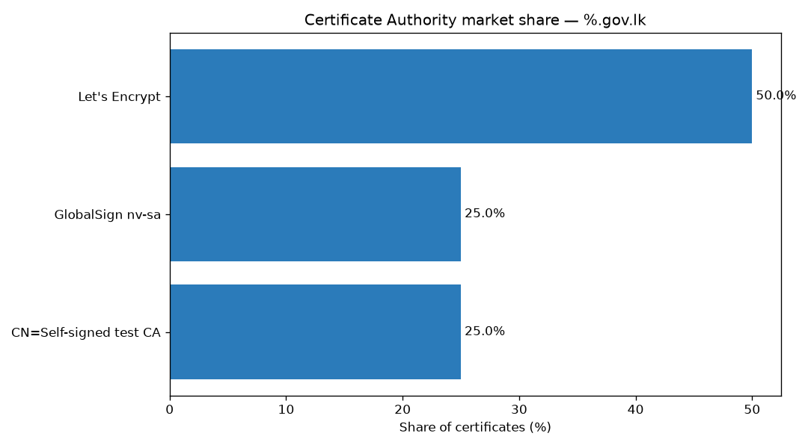
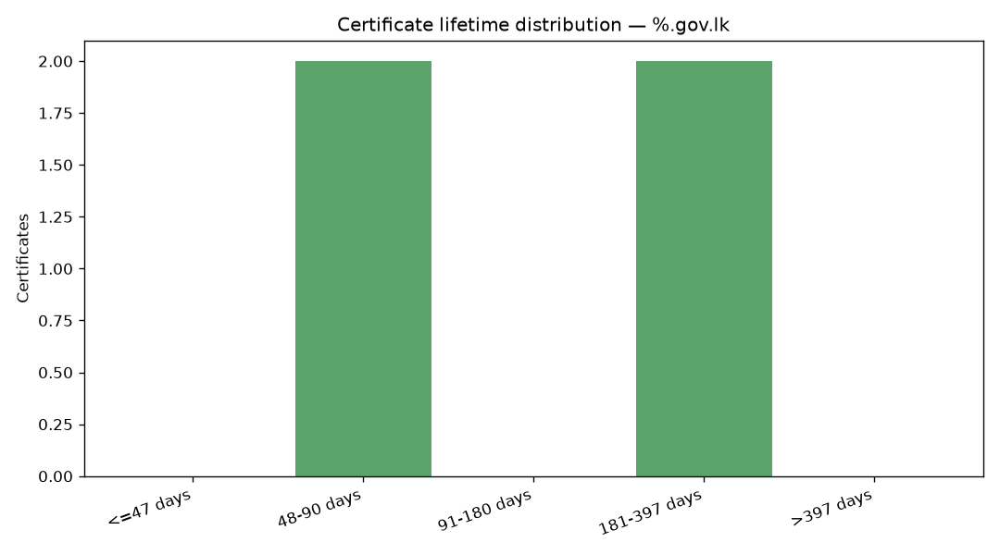
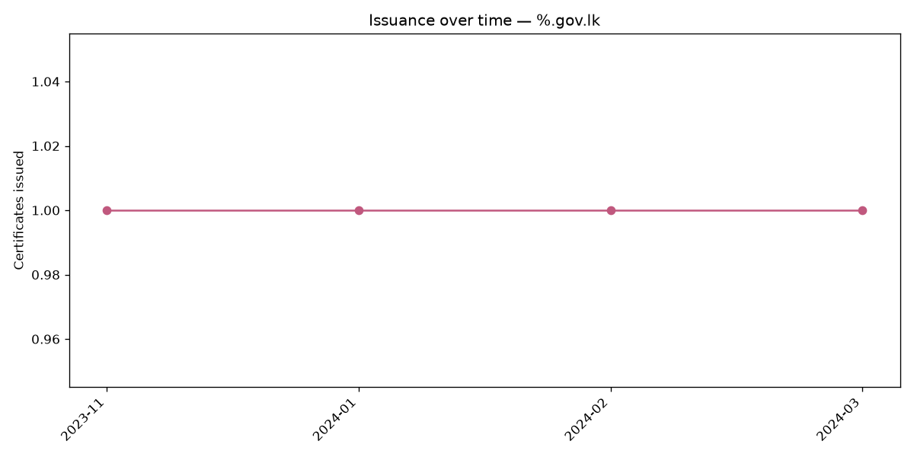

# Certificate landscape — `%.gov.lk`

*Generated by [ct-lens](https://github.com/your-org/ct-lens) on 2026-11-01 11:26 UTC from public Certificate Transparency logs. No target server was contacted.*

## Overview

- **Certificates analysed:** 4
- **Unique domains:** 6
- **Wildcard certificates:** 1
- **Largest CA share:** 50.0% (Let's Encrypt)
- **Top-3 CA concentration:** 100.0%

## Who issues HTTPS certificates?

| Certificate Authority | Certificates | Share |
| --- | ---: | ---: |
| Let's Encrypt | 2 | 50.0% |
| GlobalSign nv-sa | 1 | 25.0% |
| CN=Self-signed test CA | 1 | 25.0% |

## Certificate hygiene — lifetimes

Across 4 certificates with usable dates: min **90**, median **227.5**, mean **227.8**, max **366** days.

| Lifetime | Certificates |
| --- | ---: |
| <=47 days | 0 |
| 48-90 days | 2 |
| 91-180 days | 0 |
| 181-397 days | 2 |
| >397 days | 0 |

## Issuance over time

| Month | Certificates |
| --- | ---: |
| 2023-11 | 1 |
| 2024-01 | 1 |
| 2024-02 | 1 |
| 2024-03 | 1 |

## Charts

## Security findings

*Findings below are anonymised.*

| Category | Count |
| --- | ---: |
| exposed-host | 1 |
| suspicious-issuance | 1 |

| Severity | Category | Domain | Summary |
| --- | --- | --- | --- |
| medium | exposed-host | `vpn-staging.internal.e***.lk` | Internal/staging hostname exposed (token: internal) |
| low | suspicious-issuance | `vpn-staging.internal.e***.lk` | Certificate issued by a non-public / self-signed CA |

## Methodology & safety

- **Source:** public Certificate Transparency logs via crt.sh. Every HTTPS certificate must be logged, so CT is a near-complete public record.
- **No target contact:** ct-lens never connects to, scans, or probes any server. All findings are derived from public log metadata alone.
- **De-duplication:** pre-certificate / final-certificate pairs are collapsed so counts and CA shares are not inflated.
- **Disclosure:** sensitive individual findings should be reported privately to the affected organisation and to Sri Lanka CERT|CC / TechCERT before any non-anonymised publication.

